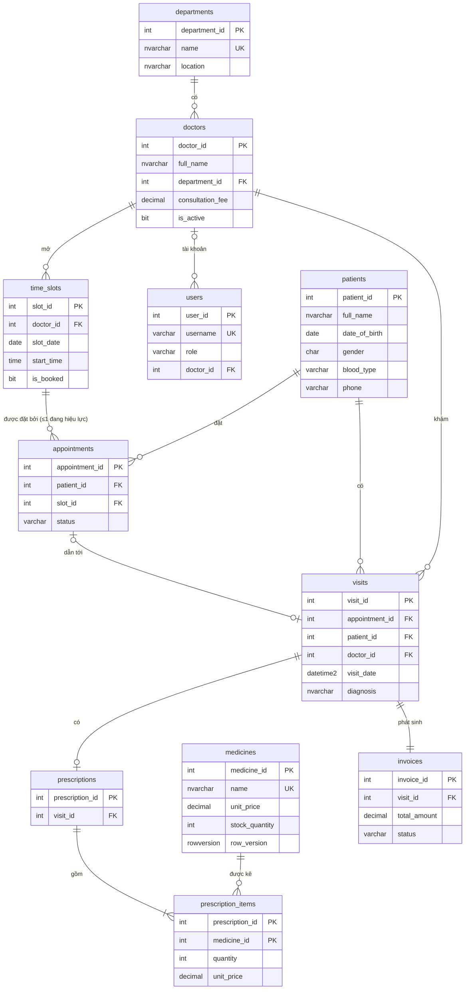

# Thiết kế dữ liệu (S1.2, S1.3)

## Nguyên tắc chia dữ liệu giữa 2 DBMS (polyglot persistence)

| Dữ liệu | DBMS | Lý do |
|---|---|---|
| Bệnh nhân, bác sĩ, lịch hẹn, lượt khám, đơn thuốc, hoá đơn, tồn kho | **SQL Server** | Có quan hệ chặt, cần ràng buộc toàn vẹn (FK, CHECK, UNIQUE), cần **transaction ACID** nhiều bảng (đặt lịch, kê đơn trừ kho, hoá đơn), cần join/subquery/aggregate linh hoạt |
| Sinh hiệu từ thiết bị, nhật ký truy cập | **Cassandra** | Ghi liên tục khối lượng lớn, append-only, truy vấn theo mẫu cố định (theo bệnh nhân + thời gian), cần scale ngang, chấp nhận eventual consistency |

Khoá nối giữa 2 DB: `patient_id`, `user_id` (INT, lấy từ SQL Server).

## SQL Server: ERD

**Ràng buộc đáng chú ý (dùng làm demo):**

| Ràng buộc | Phục vụ |
|---|---|
| `UX_appointments_active_slot`: unique **filtered** index trên `appointments(slot_id) WHERE status IN ('SCHEDULED','COMPLETED','NO_SHOW')` | Chặn double-booking ở tầng DB (topic v); filtered index (topic ii) |
| `CK_medicines_stock CHECK (stock_quantity >= 0)` | Kê đơn vượt tồn kho → lỗi → ROLLBACK (topic iv) |
| `medicines.row_version ROWVERSION` | Optimistic concurrency (topic v) |
| `invoices.total_amount` là computed column `PERSISTED` | Storage (topic i) |
| **Không** tạo index cho cột FK và cột tìm kiếm | Cố ý để topic ii đo trước/sau khi thêm index |

## Cassandra: thiết kế theo truy vấn (query-first)

| # | Truy vấn ứng dụng | Bảng | Partition key | Clustering |
|---|---|---|---|---|
| Q1 | Sinh hiệu của bệnh nhân X trong ngày D, mới nhất trước | `vital_signs_by_patient_day` | `(patient_id, day)` | `recorded_at DESC` |
| Q2 | Chỉ số mới nhất của bệnh nhân X (dashboard) | `latest_vitals_by_patient` | `patient_id` | — |
| Q3 | Các cảnh báo bất thường trong ngày D | `vital_alerts_by_day` | `day` | `recorded_at DESC, patient_id` |
| Q4 | Nhật ký truy cập của user U trong ngày D | `access_logs_by_user_day` | `(user_id, day)` | `ts DESC` (timeuuid) |

- Partition theo **(bệnh nhân, ngày)** để partition không phình vô hạn (1 thiết bị gửi 1 bản ghi/giây ≈ 86.400 dòng/ngày, vẫn dưới ngưỡng khuyến nghị ~100MB/partition).
- `TimeWindowCompactionStrategy` cho dữ liệu chuỗi thời gian (topic i).
- Một lần ghi sinh hiệu = ghi vào Q1 + Q2 (+ Q3 nếu bất thường), tức là **denormalization** thay cho join.
